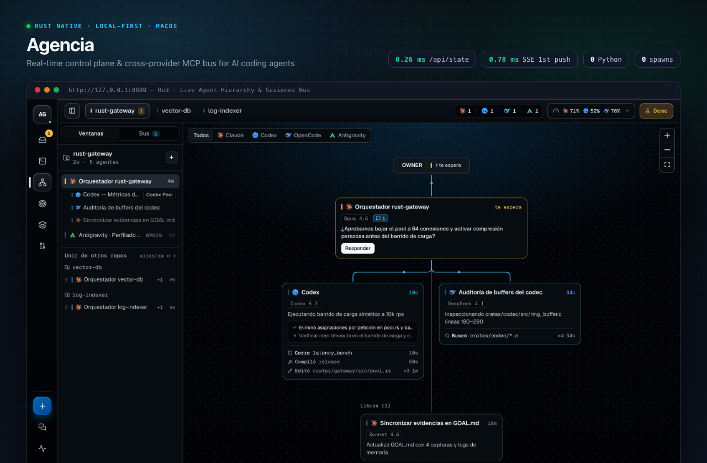
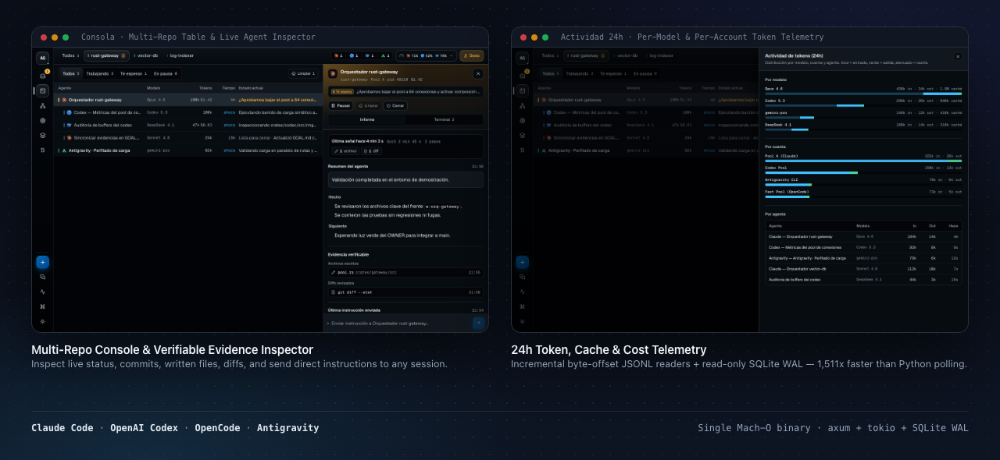
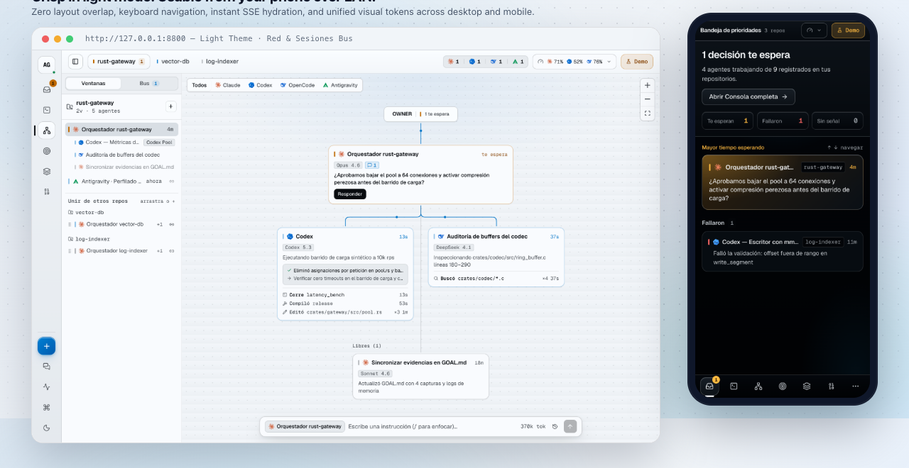
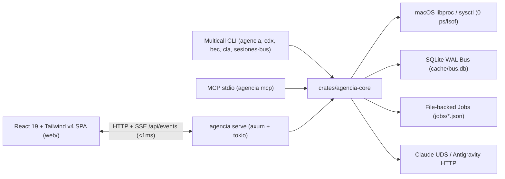

<div align="center">

# Agencia

**Fast, local-first Rust control plane, real-time dashboard, and cross-provider MCP bus for orchestrating AI coding agents on macOS.**

[](Cargo.toml)
[](#quick-start-macos)
[](#measured-performance-rust-vs-legacy-python)
[](#architecture)
[](LICENSE)

Monitor, launch, pause, inspect, and message **Claude Code**, **OpenAI Codex**, **OpenCode**, and **Antigravity** sessions from one compiled binary — zero cloud relay, zero `ps`/`lsof` polling, `< 1 ms` live API & SSE.

<br />



</div>

---

## Why Agencia?

Running multiple AI coding agents in parallel across repositories and git worktrees quickly turns terminal tabs into chaos. Agencia gives you one local control room on `http://127.0.0.1:8800`:

- **Live Agent Network & Priority Inbox**: See every running, waiting, paused, or failed session across all repos in one real-time graph (`Red`) and multi-repo table (`Consola`) — with verifiable commits, diffs, written files, and direct replies.
- **Cross-Provider Agent Bus (`sesiones` MCP + `sesiones-bus` CLI)**: SQLite WAL message bus and JSON-RPC 2.0 `stdio` MCP server (`agencia mcp`) so Claude Code, Codex, OpenCode, Antigravity, or any MCP-compatible agent can discover peers and coordinate autonomously.
- **Single Multicall Rust Binary**: One Mach-O executable (`target/release/agencia`) serves as the HTTP/SSE server, MCP server, one-word launcher (`agencia`), setup wizard (`agencia init`), and worker CLIs (`cdx`, `bec`, `cla`, `slice`, `agshot`, `agy-send`, `sesiones-bus`).
- **Sub-millisecond Telemetry**: Native macOS `libproc` / `sysctl` FFI, incremental byte-offset JSONL readers, read-only SQLite WAL queries, and instant SSE hydration with **0 subprocess spawns** on read endpoints.

<p align="center">
  
</p>

---

## Quick Start (macOS)

### Prerequisites
- macOS with Xcode Command Line Tools (`xcode-select --install`)
- [Rust toolchain](https://rustup.rs/) (Cargo 1.85+ / Edition 2024)
- Any combination of `claude` (Claude Code), `codex` (OpenAI Codex CLI), `opencode`, or `agy` (Antigravity CLI)
- *(Optional, only to edit the React UI)* Node.js 20+

### 3-Command Install

```bash
git clone https://github.com/Caliko06/agencia.git
cd agencia
./install.sh            # builds release binary and symlinks CLI tools into ~/.local/bin
agencia init            # detects your installed CLIs and writes ~/.config/agencia/config.json
agencia                 # starts http://127.0.0.1:8800 in background and opens the dashboard
```

### Let Your Own Agent Set It Up (Zero Manual Config)

Have your own preferred models, local inference (Ollama / LM Studio), or extra CLIs? Copy-paste the prompt in **[`SETUP_AGENT.md`](SETUP_AGENT.md)** into your coding agent (Claude Code, Codex, OpenCode, Cursor, Gemini CLI, etc.). It will inspect your machine, configure `~/.config/agencia/config.json`, wire `agencia mcp` into only the tools you use, and verify `:8800`.

To keep Agencia running automatically at login via `launchd`:

```bash
./install.sh --launchd
```

To try the UI immediately with synthetic data (no live sessions required), open `http://127.0.0.1:8800/?demo=1`.

---

## Dark, Light & Mobile

<p align="center">
  
</p>

---

## Measured Performance (Rust vs Legacy Python)

Measured locally on macOS (Apple Silicon) via [`tests/e2e/tier4_bench.mjs`](tests/e2e/tier4_bench.mjs):

| Operation | Legacy Python (ms) | Agencia Rust (ms) | Speedup |
|---|---:|---:|---:|
| Cold TCP listen | 115.15 | **6.43** | **17.9x** |
| Cold `GET /api/state` | 596.20 | **59.26** | **10.1x** |
| Live `GET /api/state` (10x avg) | 181.07 | **0.26** | **696x** |
| Live `GET /api/activity` (10x avg) | 1,405.64 | **0.93** | **1,511x** |
| SSE `/api/events` 1st event (10x avg) | 1,106.60 | **0.78** | **1,419x** |
| `POST /api/pulse` (10x avg) | 643.64 | **0.13** | **4,951x** |
| `GET /api/agent` inspector (10x avg) | 337.48 | **9.71** | **34.8x** |
| CLI `sesiones-bus list` (5x avg) | 512.35 | **13.05** | **39.3x** |
| CLI `bec ls` (5x avg) | 152.10 | **22.49** | **6.8x** |

All 9 read endpoints + SSE pass under a `DYLD_INSERT_LIBRARIES` `posix_spawn`/`execve` interposer with **0 subprocess spawns** (`tests/e2e/tier4_audit.sh`).

---

## Architecture



### Repository Layout

| Path | Role |
|---|---|
| `src/` | Unified binary (`main.rs`), `axum` HTTP/SSE server (`server.rs`), read/write/background modules (`snapshot/`, `control/`, `loops/`, `avance.rs`) |
| `crates/agencia-core/` | Core Rust library (`procs`, `jobs`, `bus`, `bus_mcp`, `cartero`, `agylink`, `types`) with 52 unit tests |
| `app/` → `web/` | React 19 + Vite + Tailwind v4 frontend source and prebuilt static bundle |
| `bin/` | Relative symlinks to `../target/release/agencia` |
| `tests/e2e/` | End-to-end suite (Tiers 1–4): API/CLI/MCP contract, security & load boundaries, headless browser flows, DYLD spawn audit, benchmarks, and visual checks |

---

## Multicall CLI Reference

Every tool in `bin/` is a symlink to `target/release/agencia`:

| Command | Description |
|---|---|
| `agencia` / `agencia open` | Start `:8800` if down and open the dashboard in your browser |
| `agencia init` | Detect installed AI CLIs and generate `~/.config/agencia/config.json` |
| `agencia serve` | Run the HTTP/SSE server in the foreground |
| `agencia mcp` | Run the `sesiones` JSON-RPC 2.0 MCP server over `stdio` |
| `agencia-up` | Ensure `:8800` is listening in background (`up` / `started`) |
| `cdx "task"` / `cdx wait ID` / `cdx ls` | Dispatch and track background Codex jobs |
| `bec "task"` / `bec wait ID` / `bec ls` | Dispatch and track OpenCode worker jobs |
| `cla "task"` / `cla wait ID` / `cla ls` | Dispatch and track Claude Code workers |
| `slice <name> [repo]` | Create an isolated git worktree + branch for parallel work |
| `sesiones-bus list\|send\|reply\|inbox\|wait` | CLI companion for the cross-provider agent bus |
| `agshot <png> [caption]` | Attach a screenshot to the active agent's inspector card |

### Enabling the `sesiones` MCP Server

Connect any MCP-compatible agent client to the native Rust binary (zero Python required):

<details>
<summary><b>Claude Code</b> (<code>~/.claude.json</code>)</summary>

```json
{
  "mcpServers": {
    "sesiones": {
      "type": "stdio",
      "command": "/path/to/agencia/target/release/agencia",
      "args": ["mcp"]
    }
  }
}
```
</details>

<details>
<summary><b>OpenAI Codex</b> (<code>~/.codex/config.toml</code>)</summary>

```toml
[mcp_servers.sesiones]
command = "/path/to/agencia/target/release/agencia"
args = ["mcp"]
```
</details>

<details>
<summary><b>OpenCode</b> (<code>~/.config/opencode/opencode.json</code>)</summary>

```json
{
  "mcp": {
    "sesiones": {
      "type": "local",
      "command": ["/path/to/agencia/target/release/agencia", "mcp"],
      "enabled": true
    }
  }
}
```
</details>

---

## Configuration

Agencia works out of the box with sensible defaults. Optional environment variables and user files:

| Variable / File | Purpose |
|---|---|
| `AGENCIA_PORT` | HTTP port (default: `8800`) |
| `AGENCIA_DIR` / `AGENCIA_ROOT` | Override state directory (`jobs/`, `cache/`) |
| `AGENCIA_WEB_DIR` | Override static SPA directory |
| `AGENCIA_NO_LOOPS=1` | Disable background narrator/auditor/janitor loops |
| `AGENCIA_CODEX_NAME` | Display label for the primary `~/.codex` profile (default: `Codex`) |
| `AGENCIA_BEC_MODEL` / `AGENCIA_CLA_MODEL` | Override default models for `bec` / `cla` workers |
| `AGENCIA_CONSULTOR_REPO` | Default repository path for the read-only Consultor drawer |
| `AGENCIA_RECONCILE=1` | Opt-in to the periodic 7-minute reconcile pass (off by default) |
| `~/.config/agencia/config.json` | User defaults generated by `agencia init` (`bec_model`, `cla_model`, `codex_name`) |
| `~/.config/agencia/re_targets.json` & `ghidra.json` | Optional reverse-engineering targets and Ghidra headless project for the **Lupa** view |

---

## Verification & Development

```bash
# Rust unit tests & release binary
cargo test --release
cargo build --release

# Rebuild React 19 + Tailwind v4 SPA (app/ -> web/)
cd app && npm install && npm run build

# Full end-to-end suite (Tiers 1–4: API, CLI, MCP, security, browser flows, DYLD audit, benchmarks)
./tests/e2e/run.sh --tier all --mode post --url http://127.0.0.1:8800
```

---

## License

[MIT](LICENSE)
